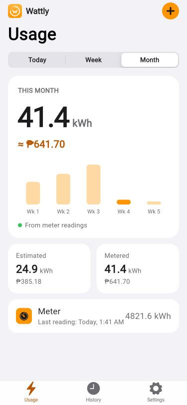
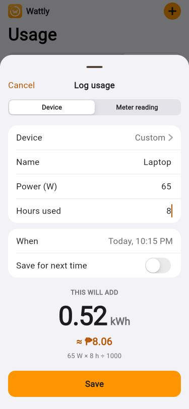
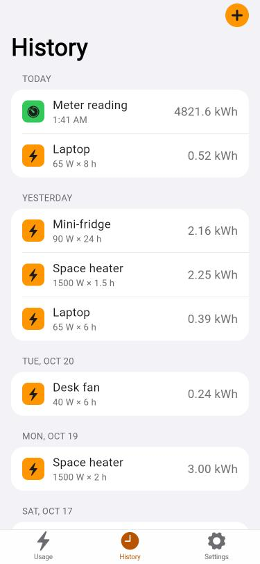
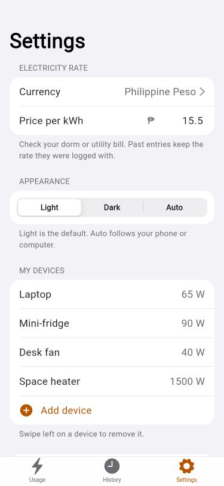
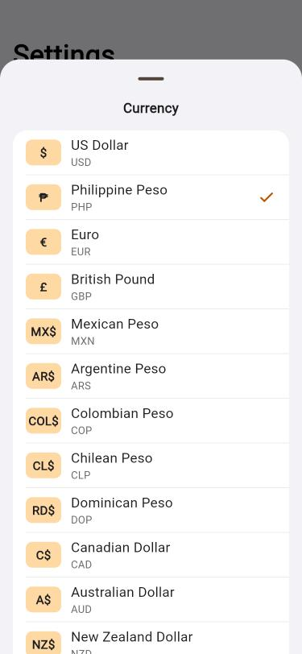

<p align="center">
  
</p>

<h1 align="center">wattly</h1>

<p align="center">
  Track your dorm's electricity use in kWh and cost.<br>
  Log what you plug in, set your price per kWh, and see where your power goes.
</p>

<p align="center">
  <a href="https://c4rlosst.github.io/wattly/"><b>Open the app →</b></a>
</p>

<p align="center">
  
  
  
  
  
</p>

## What it does

Wattly is made for students living in dorms who want to know how much electricity they use and what it costs.

- **Log usage two ways.** Add a device with its wattage and the hours it ran (`kWh = W × h ÷ 1000`), or type in a reading from your dorm's meter.
- **See your usage.** Today, this week or this month, with a bar chart, kWh and cost. When you have meter readings it uses those, and it shows your device estimate next to them.
- **Save your devices.** Enter your laptop, mini-fridge or fan wattage once, then just pick it when logging.
- **Your currency.** Pick the Philippine peso, other pesos, dollars, euros and more, or type your own symbol. Past entries keep the rate they were logged with.
- **Private.** Everything is stored on your device. No account, no server, and it works offline.
- **Light by default**, even on a computer set to dark mode, in an iOS-style design. Switch to Dark or Auto in Settings.

## Put it on your phone

Wattly is a web app, so there is nothing to install from an app store.

1. Open **https://c4rlosst.github.io/wattly/** on your phone.
2. **iPhone:** in Safari tap Share, then *Add to Home Screen*. **Android:** in Chrome open the menu, then *Install app*.

Your data lives in that phone's browser, so clearing the site's data will erase it.

## Run it yourself

Built with [Flutter](https://flutter.dev).

```
flutter pub get
flutter test
flutter run -d chrome
```

Pushing to `main` builds and deploys the web app to GitHub Pages (see `.github/workflows/pages.yml`).

## Project layout

| Path | What's there |
| --- | --- |
| `lib/calc.dart` | The kWh, cost and chart-bucket maths |
| `lib/store.dart` | App state, saved on the device |
| `lib/screens/` | Dashboard, history, settings, log-usage sheet, currency picker |
| `lib/theme.dart`, `lib/widgets.dart` | iOS-style colours and shared widgets |
| `branding/` | Logo and icon sources |
